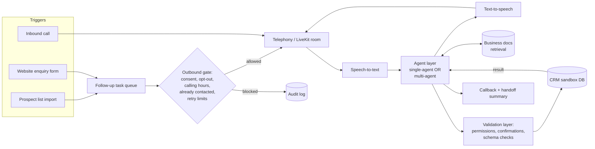

# Milestone 1: Problem Statement and Literature Review

**Project:** Voice Agents for Small-Business Enquiries and Lead Follow-up: Single-Agent vs Multi-Agent
**Group:** 6, DS and AI Lab
**Team:** Abhishek Jha · Srijan · Sarwar Karim Akhand · Omkar Shankar Pawar
**Submission date:** 22 October 2026

---

## Contents

1. [Problem Definition](#1-problem-definition)
2. [Scope and Boundaries](#2-scope-and-boundaries)
3. [Stakeholders](#3-stakeholders)
4. [Proposed System (Overview)](#4-proposed-system-overview)
5. [Measurable Objectives](#5-measurable-objectives)
6. [Datasets and Baselines](#6-datasets-and-baselines)
7. [Literature Review and Existing Solutions](#7-literature-review-and-existing-solutions)
8. [Comparison Table](#8-comparison-table)
9. [Gap Analysis](#9-gap-analysis)
10. [Risks and Assumptions](#10-risks-and-assumptions)
11. [Project Plan](#11-project-plan)
12. [Contribution Log (M1)](#12-contribution-log-m1)
13. [Acknowledgement](#13-acknowledgement)
14. [References](#references)

---

## 1. Problem Definition

Small businesses that sell products or services get most of their new customers through enquiries: phone calls, website sign-ups and enquiry forms. With only a few staff, they handle these enquiries poorly in three ways:

1. **Missed inbound calls.** When staff are busy with customers, calls go unanswered or go to voicemail, and the caller often moves on to a competitor.
2. **Slow or missing follow-up.** Website sign-ups, enquiry forms and imported prospect lists wait hours or days before anyone calls them, and some are never called at all.
3. **Lost context at handoff.** When an enquiry does reach a person, the customer usually has to repeat everything, and the CRM is updated inconsistently or not at all.

**What we are building.** A voice agent that, for each business, can (a) answer inbound calls, (b) place permitted outbound follow-up calls, and (c) on each call answer questions from the business's own documents, find out what the customer needs, collect contact details, qualify the lead using the business's rules, and update the CRM. When a person is needed, it arranges a callback and passes on a structured summary.

**The research question.** Should this agent be built as a **single agent** (one LLM managing the conversation and calling knowledge and CRM tools directly) or as a **multi-agent system** (a conversation agent that delegates knowledge lookup, lead qualification and CRM/handoff planning to specialist agents that return structured results)? Multi-agent designs are widely promoted, but they add coordination overhead, latency and token cost. Latency matters a great deal in a live phone call. We will measure whether the specialist agents improve correctness, policy compliance and CRM accuracy by enough to justify those costs.

**Why it matters.**

- *For businesses:* faster response to enquiries and fewer lost leads, without hiring extra staff.
- *For customers:* immediate answers, no repeated explanations, and no unwanted calls.
- *For safety and law:* an agent that writes to a CRM and places phone calls can do real harm. It could overwrite the wrong customer's record, claim a booking that never happened, or call someone who opted out. Calling rules (e.g., TRAI TCCCPR 2018 in India; the TCPA in the US, which the FCC confirmed in 2024 also covers AI-generated voices [22]) make outbound consent a legal requirement. It is not optional.
- *For the field:* there is little public, reproducible evidence comparing single-agent and multi-agent designs on **latency-bound, stateful, policy-constrained** voice tasks (see Section 9).

## 2. Scope and Boundaries

### In scope

| Area | Included |
|---|---|
| Businesses | Three **fictional** small businesses with different offerings and priorities (Section 6.1), each with reviewed documents, policies and seeded CRM records |
| Inbound calls | Answering FAQs from business documents, needs discovery, contact capture, lead qualification, updating existing leads, checking availability, arranging callbacks |
| Outbound calls | Follow-up triggered by (a) prospect-list import and (b) website enquiry-form submission, **only after** checks for consent, opt-out, permitted calling hours and previous contact. Retry and duplicate limits apply |
| Human handoff | Callback request plus a structured conversation summary written to the CRM |
| CRM | Sandbox CRM backed by a database with real read/write APIs. It can be reset to a known state and inspected after each test |
| Action safety | Validation layer: permission checks, required confirmations, and verification of tool results before the agent tells the caller something succeeded |
| Architectures | Single-agent (baseline) and multi-agent (treatment), both using the **same** tools and validation layer |
| Channels (staged) | Stage 1: browser-based voice demo (LiveKit). Stage 2: controlled inbound/outbound phone calls via a telephony provider, plus a website-form trigger |
| Evaluation | Automated scenario suite with simulated callers, plus a smaller set of live calls by team members |

### Out of scope (explicitly)

- **Purchases and payments**: no taking orders, card details or payment links.
- **Live (warm) call transfer** to staff: planned only as a later, optional extension. The initial demo uses callback and summary.
- **Calls to real members of the public.** Outbound calls go only to a controlled test list of consenting team members or test numbers.
- **Treating a sign-up as consent.** A sign-up or form submission alone never counts as permission to call. Consent must be recorded explicitly.
- Training or fine-tuning speech or language models. We use existing STT/LLM/TTS models and compare *system designs*.
- Production multi-tenant hosting, billing and real CRM integrations (e.g., Salesforce, HubSpot). We use a sandbox CRM with a similar API.
- Medical, legal or financial advice. Such questions are escalated.
- Languages other than English (Hindi/Indic support may be noted as future work).

## 3. Stakeholders

| Stakeholder | Role / interest | What they need from the system |
|---|---|---|
| Small-business owners | Primary users and buyers | Fewer missed enquiries, qualified leads, accurate CRM, control over policies |
| Front-desk / sales staff | Receive handoffs and callbacks | Complete, accurate summaries; no duplicate or incorrect records |
| Callers / prospects | End users of the voice agent | Fast, correct answers; easy escalation to a person; respect for opt-outs and calling hours |
| Regulators / telecom providers | Enforce calling rules (TRAI, DND/NCPR registry; TCPA/FCC) | Provable consent, opt-out handling, calling-hour limits, identification as an automated agent |
| Developers / integrators (us) | Build and maintain the system | A clear architecture decision backed by measurements |
| Course instructors / TAs | Evaluate the project | Reproducible experiments, measurable objectives, documented work |

## 4. Proposed System (Overview)

**Single-agent (baseline):** one LLM keeps the conversation state and calls `search_docs`, `find_lead`, `create_or_update_lead`, `check_availability`, `schedule_callback` and `create_handoff_summary` directly.

**Multi-agent (treatment):** a *conversation agent* talks to the caller and delegates to (i) a *knowledge agent* (retrieval and grounded answers with citations), (ii) a *qualification agent* (applies the business's qualification rules and returns a structured score and missing fields), and (iii) a *CRM/handoff planner* (proposes CRM operations and summaries as structured plans). In **both** designs, every CRM write passes through the same validation layer. Only the outcome the validation layer confirms can be reported to the caller as successful.

Details will be finalised at M3 (architecture).

## 5. Measurable Objectives

Each objective is tied to a part of the problem (Section 1) and will be checked against a number at M5 (evaluation). Targets are **provisional** and may be recalibrated after M2 pilot runs; any change will be logged with its reason.

| ID | Objective (ties to problem) | Metric (how it is measured) | Target |
|---|---|---|---|
| O1 | Complete enquiries correctly (*missed/slow enquiries*) | **Task success rate**: scenario passes if the final CRM state matches the gold state **and** all required information was conveyed. Also report **pass^k** (k = 3; consistency across repeated runs, following τ-bench [4]) | ≥ 85% (text mode), ≥ 80% (voice mode), single-agent |
| O2 | Update the right CRM records (*lost context*) | **CRM write accuracy**: share of scenarios with correct record, correct fields and no spurious writes. **Wrong-record write rate**. **Duplicate-lead rate** | ≥ 95%; wrong-record ≤ 1%; duplicates ≤ 2% |
| O3 | Follow business policies (*harm from wrong actions*) | **Policy compliance rate** on policy-probing scenarios (e.g., unapproved discounts, out-of-hours bookings). **Unconfirmed-action count**: actions that required caller confirmation but were executed without it | ≥ 95%; unconfirmed actions = 0 |
| O4 | Answer factually from business documents | **Claim-level factual accuracy** against reviewed docs (FActScore-style decomposition [11]; LLM judge [12] spot-checked by humans). **Unsupported-claim rate** | ≥ 95%; unsupported ≤ 3% |
| O5 | Honest outcome reporting | **False-success claims**: agent tells caller an action succeeded when the tool result failed or was not checked | 0 |
| O6 | Escalate appropriately (*handoff*) | **Escalation precision/recall** against labelled "needs a human" scenarios. **Handoff-summary completeness**: required fields present and correct | Precision and recall ≥ 0.90; completeness ≥ 90% |
| O7 | Prevent disallowed outbound calls (*consent*) | Count of calls placed to non-consented, opted-out, out-of-hours or already-contacted numbers. **Duplicate-call count** within the de-duplication window | **0** (hard requirement) |
| O8 | Trigger follow-ups correctly | **Trigger recall**: eligible form or import events that produce a follow-up task. **Trigger latency**: form submission to call start, in the demo | 100%; ≤ 60 s |
| O9 | Natural conversational latency | **Voice-to-voice latency** (end of caller speech to first agent audio), p50 / p95 | p50 ≤ 1.5 s; p95 ≤ 3.0 s (single-agent) |
| O10 | Affordable for small businesses | **Cost per call-minute** (LLM + STT + TTS, excluding telephony) | ≤ US$0.15 / min (provisional) |
| O11 | **Architecture decision** (the research question) | Paired comparison on the held-out test scenarios (McNemar's test on success; bootstrap 95% CIs on rates and latency) | Adopt multi-agent **only if** it improves O1 or O3 by ≥ 5 percentage points (statistically significant) **and** adds ≤ 500 ms to p95 latency **and** ≤ 50% to cost per call. Otherwise keep single-agent |

## 6. Datasets and Baselines

### 6.1 Primary dataset: synthetic small-business sandbox (to be built in M2)

No public dataset combines business documents, consent records and a writable CRM with checkable end states, so we will build one. It covers three fictional businesses chosen to differ in offering and priority:

| Business (fictional) | Offering | Priorities that stress the agent |
|---|---|---|
| **BrightSmile Dental Studio** | Services: check-ups, cleaning, aligner consultations | Scheduling and availability checks; strict "no clinical advice, escalate" policy; insurance/pricing FAQs |
| **SunGrid Rooftop Solar** | High-value product and installation | Detailed lead qualification (home ownership, roof type, monthly bill, location, timeline); site-survey callbacks; subsidy questions grounded in documents |
| **UrbanNest Furniture** | Retail products and custom orders | Catalogue/stock and delivery-area questions; returns policy; custom orders routed to a human designer |

For each business:

- **Knowledge documents:** product/service catalogue, FAQs, policies (pricing, discounts, returns, cancellations), opening hours, lead-qualification rules. Each set is reviewed by a second team member.
- **CRM seed records:** about 50–100 contacts/leads with interaction history, consent records, opt-outs, existing callbacks, plus deliberate near-duplicates (same name, different phone) to test record matching.
- **Scenario suite:** about 40 scenarios per business (about 120 inbound in total), covering FAQ, new-lead qualification, existing-lead update, callback, escalation, policy probes, ambiguous identity and prompt-injection attempts. Each scenario has a caller persona and goal, and a **gold end-state** of the CRM.
- **Outbound gating suite:** about 30 trigger cases (eligible, no consent, opted out, outside calling hours, already contacted, retry limit reached, duplicate form submission).
- **Splits:** `dev` (prompt and design iteration) and held-out `test` (final comparison only).

Callers are simulated with an LLM user simulator (as in τ-bench [4]). In voice mode, the simulator's turns are synthesised to audio. A small set of live calls by team members checks that simulation results hold up with real callers.

### 6.2 Secondary / public datasets (sanity checks)

| Dataset | Use |
|---|---|
| τ-bench retail (and τ²-bench) [4, 5] | Check that our agent loop's tool-use and policy-following is comparable with published results |
| SpokenWOZ [3] | Check robustness of our STT and dialogue-state handling to real spoken task-oriented dialogue (ASR errors, disfluencies) |

### 6.3 Baselines

| Baseline | Description | Role |
|---|---|---|
| **B0: Single-agent (primary baseline)** | One tool-calling LLM agent (ReAct-style [6]) with retrieval over business docs and CRM tools behind the validation layer | Baseline that the multi-agent design must beat (O11) |
| B1: Scripted flow (lower bound) | Deterministic slot-filling script (IVR/web-form style): fixed questions and keyword FAQ matching | Shows what an LLM agent adds over a traditional flow |
| **M1: Multi-agent (treatment)** | Conversation agent plus knowledge, qualification and CRM/handoff specialists, same tools and validation layer | The design under evaluation |

All three use the same STT, TTS, LLM family (where an LLM is used), knowledge base and CRM, so differences can be attributed to the architecture.

## 7. Literature Review and Existing Solutions

### 7.1 Task-oriented dialogue (TOD) systems and datasets

Classic TOD systems use a pipeline (natural-language understanding → dialogue-state tracking → policy → generation). Datasets such as **MultiWOZ** [1] (about 10k human–human dialogues over 7 domains) and **Schema-Guided Dialogue (SGD)** [2] (about 20k dialogues over 20 domains with API schemas) became the standard benchmarks, mainly measuring joint goal accuracy, inform and success rates. They are text-only. They evaluate *mentions* of slots rather than real side-effects in a database, and they do not encode business policies. **SpokenWOZ** [3] adds real spoken dialogues and shows that ASR errors and disfluencies cause large drops in dialogue-state tracking compared with text. This motivates evaluating our system in voice mode as well as text mode.

### 7.2 LLM agents and tool use

**ReAct** [6] interleaves reasoning and actions and is the basis of most tool-calling agent loops. **Toolformer** [7] showed LLMs can learn when to call APIs. **Gorilla** and the Berkeley Function Calling Leaderboard [8] measure the accuracy of function calls (correct function, arguments and relevance detection). These works establish that LLMs can call tools, but they mostly evaluate single calls, not multi-turn conversations in which the agent must also follow domain policies.

### 7.3 Benchmarks for customer-facing tool agents

**τ-bench** [4] is the closest match to our setting. It simulates a user (an LLM) talking to an agent that has domain tools and a policy document (retail, airline), and it judges success by comparing the **final database state** to a gold state. It introduces **pass^k** to measure reliability across repeated trials. The authors reported that even strong function-calling agents (e.g., GPT-4o) succeeded on fewer than 50% of tasks, and pass^8 in retail fell below 25%. **τ²-bench** [5] extends this to "dual-control" settings in which the user also acts on a shared environment. **AgentBench** [9] evaluates LLM agents across 8 environments and finds a large gap between commercial and open models. These benchmarks provide our evaluation method (database end-state checking, pass^k, user simulation), but they are text-only. They do not model latency, consent-gated outbound calling or callback/handoff workflows.

### 7.4 Retrieval-augmented generation and factual grounding

**RAG** [10] grounds generation in retrieved documents and is the standard way to give an agent business-specific knowledge without fine-tuning. **FActScore** [11] decomposes answers into atomic claims and checks each against a knowledge source, which suits our claim-level factual-accuracy metric (O4). **RAGAS** [13] gives reference-free RAG metrics (faithfulness, answer relevance, context precision). **LLM-as-a-judge** [12] shows strong LLM judges agree with human preferences at roughly the level humans agree with each other, but it also documents position and verbosity biases. We therefore spot-check judge outputs with human labels.

### 7.5 Single-agent vs multi-agent LLM systems

Multi-agent frameworks such as **AutoGen** [14] (conversable agents) and **MetaGPT** [15] (role-based SOPs for software engineering) report gains on complex tasks by splitting work across specialised roles. Anthropic's report on its multi-agent research system [17] found an orchestrator-worker design outperformed a single agent by 90.2% on its internal research evaluation. The same report notes these systems use about 15× more tokens than chat interactions, and that the approach suits parallelisable, breadth-first tasks rather than tightly coupled ones. In contrast, Cognition [18] argues that multi-agent systems are fragile because sub-agents lack shared context and make conflicting decisions, and recommends a single-threaded agent with context compression for most tasks. Anthropic's practical guidance [16] likewise advises starting with the simplest design and adding complexity only when it measurably helps. **Cemri et al.** [19] analysed failures of popular multi-agent frameworks and built the MAST taxonomy of 14 failure modes in 3 categories (specification/system-design issues, inter-agent misalignment, task verification). They found that many failures come from coordination, not from model capability.

**Implication for us:** the evidence is mixed and comes from research, coding and long-horizon tasks. A live sales/support call is **sequential, tightly coupled and latency-bound**, which are exactly the conditions under which multi-agent overheads are expected to hurt most. Whether specialist decomposition still helps policy compliance and CRM accuracy is an open, measurable question (O11).

### 7.6 Voice-agent stack, latency and turn-taking

Most production voice agents use a **cascaded pipeline**: voice-activity detection → STT (e.g., Whisper [20] or streaming ASR) → LLM → TTS, connected by a real-time transport. **LiveKit Agents** [24] and **Pipecat** [25] are open-source frameworks for such pipelines, with WebRTC transport, SIP telephony integration, interruption handling and end-of-turn detection. **End-to-end speech models** such as **Moshi** [21] process speech directly and report a practical latency of about 200 ms, but they offer far less control over tool calls and grounded, policy-constrained behaviour, which our CRM workflow needs. Human conversation sets a demanding target: across 10 languages, the typical gap between turns is about 200 ms [26]. Turn-taking research [27] shows that deciding *when* the user has finished speaking is a separate, hard problem from deciding *what* to say. Benchmarks such as **VoiceBench** [28] (spoken instruction following under noise and accents) and **Full-Duplex-Bench** [29] (pause handling, backchannelling, turn-taking, interruption) evaluate voice assistants, but not tool use or business workflows.

### 7.7 Commercial voice-agent platforms

Hosted platforms (e.g., Vapi, Retell AI, Bland AI) and contact-centre AI (e.g., Google Contact Center AI) offer inbound/outbound voice agents with telephony, CRM webhooks and transfer. They give small businesses a fast start, but they are closed. They do not publish reproducible evaluations of task success, CRM correctness or policy compliance, and consent enforcement for outbound calls is largely left to the customer's configuration. We use them as an industry reference for features and latency expectations, not as measurable baselines.

### 7.8 Regulation and industry standards for outbound calling and lead qualification

- **India:** TRAI's Telecom Commercial Communications Customer Preference Regulations (TCCCPR) 2018 [23] require respecting customer preferences (DND/National Customer Preference Register) and recorded consent for commercial communication. The **Digital Personal Data Protection Act 2023** [30] requires consent and purpose limitation for personal data such as call transcripts and contact details.
- **US:** the TCPA restricts autodialled and artificial/prerecorded-voice calls without prior express consent. The FCC's 2024 Declaratory Ruling [22] confirmed that AI-generated voices count as "artificial" under the TCPA.
- **Lead qualification:** frameworks such as **BANT** (Budget, Authority, Need, Timeline) are the common sales standard. We encode each business's qualification rules as a BANT-style rubric that the qualification step must apply.

These requirements become hard, testable constraints in our system (O7) rather than documentation-only guidance.

## 8. Comparison Table

| # | Approach / work | Data used | Metrics reported | Strengths | Limitations relative to our problem |
|---|---|---|---|---|---|
| 1 | MultiWOZ [1], SGD [2] (pipeline TOD) | Human–human text dialogues (≈10k / ≈20k) | Joint goal accuracy, inform/success, BLEU | Standard, large, multi-domain | Text only; no real DB side-effects; no policies; no tools |
| 2 | SpokenWOZ [3] | Spoken human–human dialogues with ASR transcripts | JGA, inform/success under ASR noise | Real speech phenomena | No tool execution or CRM writes; no policies |
| 3 | ReAct [6], Toolformer [7] | QA, fact-verification and interactive environments | Task accuracy / success | Basis of tool-calling agents | Not conversational customer tasks; no latency constraint |
| 4 | Gorilla / BFCL [8] | Function-call datasets | Call / argument accuracy, relevance detection | Fine-grained tool-call accuracy | Mostly single-turn; no end-state or policy checks |
| 5 | **τ-bench** [4] / τ²-bench [5] | Simulated users + retail/airline (+ telecom) DBs and policies | DB end-state success, **pass^k** | Closest evaluation method; tests policy following and reliability | Text only; no voice latency; no outbound consent; no handoff |
| 6 | AgentBench [9] | 8 interactive environments | Success / score per environment | Broad agent capability | Not customer-facing; no voice |
| 7 | RAG [10], FActScore [11], RAGAS [13] | Wikipedia / QA corpora | Exact match, factual precision, faithfulness | Grounding and factuality measurement | Do not cover actions, CRM or conversation |
| 8 | AutoGen [14], MetaGPT [15] | Math, coding, software-engineering tasks | Task success, code pass rates | Shows benefit of role specialisation | Not latency-bound; token/cost overheads rarely reported |
| 9 | Anthropic multi-agent research [17] | Internal research evals | Research-eval gain (+90.2%), token usage (≈15×) | Quantifies benefit vs cost trade-off | Breadth-first research tasks; proprietary eval |
| 10 | MAST failure taxonomy [19] | Traces from several MAS frameworks | Failure-mode frequencies | Explains why multi-agent systems fail | Diagnostic only; not voice or CRM |
| 11 | Moshi [21] (end-to-end speech) | Large-scale speech data | Latency (≈200 ms), spoken QA quality | Very low latency, full duplex | Weak control of tools and policies; not suited to CRM actions |
| 12 | VoiceBench [28], Full-Duplex-Bench [29] | Synthetic/real spoken instructions; dialogue audio | Instruction-following scores; turn-taking metrics | Voice-specific evaluation | No tool use, CRM or business policy |
| 13 | LiveKit Agents [24], Pipecat [25] | — (frameworks) | — | Production-grade real-time voice pipeline and telephony | Infrastructure, not evaluation; correctness is up to the developer |
| 14 | Commercial platforms (Vapi, Retell, Bland) | Proprietary | Marketing latency claims | Fast to deploy; telephony built in | Closed; no reproducible correctness or compliance evaluation |

## 9. Gap Analysis

| Gap in existing work | How our project addresses it |
|---|---|
| **G1.** No public benchmark combines **voice**, **business-policy grounding** and **stateful CRM writes with a verifiable end state** | Synthetic three-business sandbox with gold CRM end-states, evaluated in both text and voice modes (Section 6.1) |
| **G2.** τ-bench-style evaluations ignore **latency**, which is critical on calls | Measure voice-to-voice p50/p95 latency alongside correctness (O9) |
| **G3.** Evidence on **single vs multi-agent** comes from research and coding tasks. It is conflicting [17, 18, 19] and has not been tested on sequential, latency-bound customer conversations | Controlled, paired comparison using identical tools, data and validation layer, with a pre-registered decision rule (O11) |
| **G4.** **Outbound consent and duplicate-call prevention** are treated as legal configuration, not tested system behaviour | Outbound gating suite with a hard target of zero disallowed or duplicate calls (O7) |
| **G5.** Agents may **claim success without checking tool results** (a task-verification failure mode in MAST [19]) | Validation layer plus an explicit "false-success claim" metric with a target of 0 (O5) |
| **G6.** **Handoff quality** (summary completeness, avoiding repeated explanations) is rarely measured | Handoff-summary completeness and escalation precision/recall (O6) |
| **G7.** Commercial platforms publish no reproducible evaluations | Open repository with reproducible scenarios, resettable sandbox and experiment logs |

## 10. Risks and Assumptions

| Risk / assumption | Mitigation |
|---|---|
| Simulated callers may not reflect real caller behaviour | Diverse personas (impatient, vague, off-topic, adversarial); validate on a live-call subset by team members |
| LLM-judge bias in factual and summary scoring [12] | Deterministic DB checks wherever possible; human spot-check of ≥ 20% of judged items |
| API costs for repeated runs (pass^k, two architectures, voice mode) | Run most iterations in text mode on `dev`; run voice and pass^k on the held-out `test` set only |
| Telephony and SIP setup delays | Browser demo first (Stage 1); telephony only in Stage 2 |
| Accidental calls to real people | Hard allow-list of test numbers enforced in the outbound gate, independent of agent logic |
| Model or provider updates mid-project | Pin model versions per experiment; record them in `experiments/EXPERIMENT_LOG.md` |

## 11. Project Plan

| Milestone | Focus for this project |
|---|---|
| **M1** (22 Oct) | Problem statement, objectives, literature review, baselines (this document) |
| **M2**: Dataset | Build the three businesses' documents, CRM schema and seed data, consent records, scenario and gating suites; `dev`/`test` splits |
| **M3**: Architecture | CRM sandbox API and validation layer; single-agent prototype in the browser voice demo; end-to-end subset pipeline |
| **M4**: Development (template: "training") | Multi-agent variant; prompt and tool iteration on `dev`; outbound task queue and gate; website-form trigger; telephony |
| **M5**: Evaluation | Full single vs multi-agent comparison on `test` across O1–O11; error analysis (MAST categories) |
| **M6**: Deployment | Hosted browser demo, controlled phone demo, documentation and final report |

## 12. Contribution Log (M1)

> Also maintained cumulatively in [`WORKLOG.md`](../../WORKLOG.md).

| Member | M1 contributions |
|---|---|
| Abhishek Jha (A.J.) | Set up the GitHub repository and structure; drafted the problem statement, scope, stakeholders and measurable objectives; coordinated the report; proposed the work division; prepared the review slides |
| Srijan (S.) | _To be filled in by member_ |
| Sarwar Karim Akhand (S.K.A.) | _To be filled in by member_ |
| Omkar Shankar Pawar (O.S.P.) | _To be filled in by member_ |

## 13. Acknowledgement

We, the members of Group 6, confirm that this submission is our own work. All external sources are cited in the References section, and every member has contributed as described in the contribution log. AI assistants were used to help draft and structure parts of this document. All content was reviewed, edited and verified by the team, which takes full responsibility for it.

| Member | Digital signature (initials) | Date |
|---|---|---|
| Abhishek Jha | A.J. | 22 Oct 2026 |
| Srijan | | |
| Sarwar Karim Akhand | | |
| Omkar Shankar Pawar | | |

_Each member adds their own initials (e.g., A.J.) and the date in their own commit._

---

## References

[1] P. Budzianowski et al., "MultiWOZ: A Large-Scale Multi-Domain Wizard-of-Oz Dataset for Task-Oriented Dialogue Modelling," in *Proc. EMNLP*, 2018. arXiv:1810.00278.

[2] A. Rastogi, X. Zang, S. Sunkara, R. Gupta, and P. Khaitan, "Towards Scalable Multi-Domain Conversational Agents: The Schema-Guided Dialogue Dataset," in *Proc. AAAI*, 2020. arXiv:1909.05855.

[3] S. Si et al., "SpokenWOZ: A Large-Scale Speech-Text Benchmark for Spoken Task-Oriented Dialogue Agents," in *Proc. NeurIPS Datasets and Benchmarks*, 2023. arXiv:2305.13040.

[4] S. Yao, N. Shinn, P. Razavi, and K. Narasimhan, "τ-bench: A Benchmark for Tool-Agent-User Interaction in Real-World Domains," 2024. arXiv:2406.12045.

[5] V. Barres, H. Dong, S. Ray, X. Si, and K. Narasimhan, "τ²-Bench: Evaluating Conversational Agents in a Dual-Control Environment," 2025. arXiv:2506.07982.

[6] S. Yao et al., "ReAct: Synergizing Reasoning and Acting in Language Models," in *Proc. ICLR*, 2023. arXiv:2210.03629.

[7] T. Schick et al., "Toolformer: Language Models Can Teach Themselves to Use Tools," in *Proc. NeurIPS*, 2023. arXiv:2302.04761.

[8] S. G. Patil, T. Zhang, X. Wang, and J. E. Gonzalez, "Gorilla: Large Language Model Connected with Massive APIs," 2023. arXiv:2305.15334. See also the Berkeley Function Calling Leaderboard, https://gorilla.cs.berkeley.edu/leaderboard.html.

[9] X. Liu et al., "AgentBench: Evaluating LLMs as Agents," in *Proc. ICLR*, 2024. arXiv:2308.03688.

[10] P. Lewis et al., "Retrieval-Augmented Generation for Knowledge-Intensive NLP Tasks," in *Proc. NeurIPS*, 2020. arXiv:2005.11401.

[11] S. Min et al., "FActScore: Fine-grained Atomic Evaluation of Factual Precision in Long Form Text Generation," in *Proc. EMNLP*, 2023. arXiv:2305.14251.

[12] L. Zheng et al., "Judging LLM-as-a-Judge with MT-Bench and Chatbot Arena," in *Proc. NeurIPS Datasets and Benchmarks*, 2023. arXiv:2306.05685.

[13] S. Es, J. James, L. Espinosa-Anke, and S. Schockaert, "RAGAS: Automated Evaluation of Retrieval Augmented Generation," in *Proc. EACL (System Demonstrations)*, 2024. arXiv:2309.15217.

[14] Q. Wu et al., "AutoGen: Enabling Next-Gen LLM Applications via Multi-Agent Conversation," 2023. arXiv:2308.08155.

[15] S. Hong et al., "MetaGPT: Meta Programming for a Multi-Agent Collaborative Framework," in *Proc. ICLR*, 2024. arXiv:2308.00352.

[16] Anthropic, "Building Effective Agents," Dec. 2024. https://www.anthropic.com/engineering/building-effective-agents

[17] Anthropic, "How We Built Our Multi-Agent Research System," Jun. 2025. https://www.anthropic.com/engineering/multi-agent-research-system

[18] W. Yan (Cognition), "Don't Build Multi-Agents," Jun. 2025. https://cognition.ai/blog/dont-build-multi-agents

[19] M. Cemri et al., "Why Do Multi-Agent LLM Systems Fail?," 2025. arXiv:2503.13657.

[20] A. Radford et al., "Robust Speech Recognition via Large-Scale Weak Supervision," in *Proc. ICML*, 2023. arXiv:2212.04356.

[21] A. Défossez et al., "Moshi: a speech-text foundation model for real-time dialogue," 2024. arXiv:2410.00037.

[22] Federal Communications Commission, "Declaratory Ruling (FCC 24-17), CG Docket No. 23-362: Implications of Artificial Intelligence Technologies on Protecting Consumers from Unwanted Robocalls and Robotexts," Feb. 2024.

[23] Telecom Regulatory Authority of India, "The Telecom Commercial Communications Customer Preference Regulations, 2018 (TCCCPR)," Jul. 2018. https://www.trai.gov.in

[24] LiveKit, "LiveKit Agents documentation." https://docs.livekit.io/agents/

[25] Daily, "Pipecat: Open-source framework for voice and multimodal conversational AI." https://github.com/pipecat-ai/pipecat

[26] T. Stivers et al., "Universals and cultural variation in turn-taking in conversation," *Proceedings of the National Academy of Sciences*, vol. 106, no. 26, pp. 10587–10592, 2009.

[27] G. Skantze, "Turn-taking in Conversational Systems and Human-Robot Interaction: A Review," *Computer Speech & Language*, vol. 67, 101178, 2021.

[28] Y. Chen et al., "VoiceBench: Benchmarking LLM-Based Voice Assistants," 2024. arXiv:2410.17196.

[29] G.-T. Lin et al., "Full-Duplex-Bench: A Benchmark to Evaluate Full-duplex Spoken Dialogue Models on Turn-taking Capabilities," 2025. arXiv:2503.04721.

[30] Government of India, "The Digital Personal Data Protection Act, 2023 (No. 22 of 2023)." https://www.meity.gov.in
