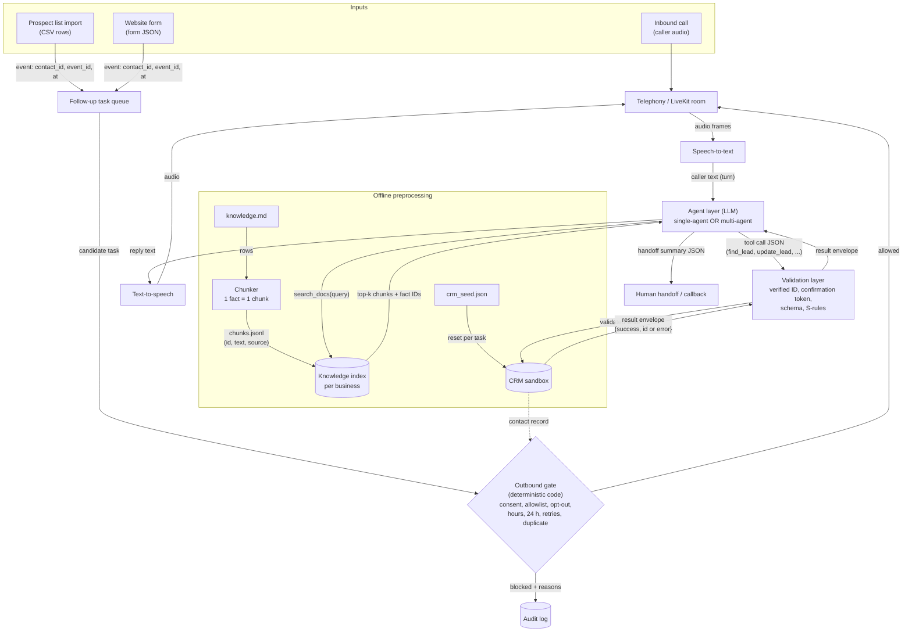
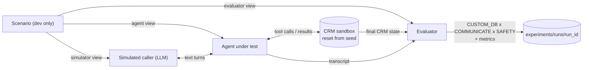
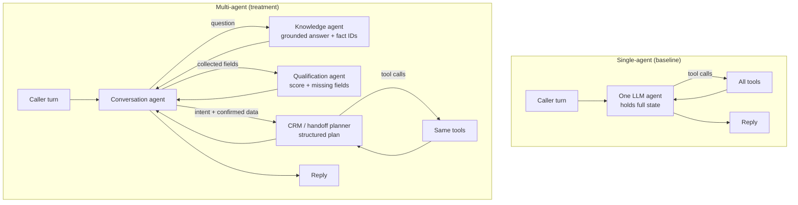

# Milestone 3: Model Architecture and End-to-End Pipeline

**Project:** Voice agent for small-business enquiries and lead follow-up: single-agent vs multi-agent  
**Group 6:** Srijan · Abhishek Jha · Sarwar Karim Akhand · Omkar Shankar Pawar  
**Due:** 5 November 2026  
**Status:** DRAFT skeleton for team review. Sections marked **TODO** must be completed by the named owner. Nothing below claims a pipeline run, a score or a measurement that has not happened.

> **How to use this draft:** keep the headings, replace every `TODO (owner)` block with real content, and delete this note before submission. Do not fill result tables with expected or invented numbers; leave "not run" if a component is unfinished and say so in Section 4.4.

---

## 0. Summary

Our system is **not a trained model**. It is an LLM-based voice agent built from pretrained components (speech-to-text, an LLM with tool calling, text-to-speech) around a **deterministic CRM sandbox, a validation layer and a deterministic outbound gate**. "Architecture" therefore means the components, prompts, tool schemas and data flow; "training" is replaced by prompt, retrieval and model-configuration experiments (see Section 5.1).

For M3 we verify the pipeline in **text mode** first (the same choice as τ-bench / τ²-bench, where the agent is tested over text before audio is added), on a **small dev-only subset** of one business, with the **single-agent** design. Voice and the multi-agent design are described here and wired in afterwards; Section 4.4 lists exactly what is and is not running.

`TODO (Abhishek, last step)`: rewrite this summary in 4–5 lines once Section 4 has real results.

---

## 1. Dataset organisation and preprocessing

### 1.1 How the data is stored

All data is **synthetic** and committed as small UTF-8 Markdown/JSON files (about 0.5 MB in total); there is no personal or sensitive data, so nothing needs to be held outside the repository. Each business has a *pilot* pack (hand-reviewed, 10 scenarios) and *generated expansions* (contacts, scenarios, outbound cases). A split manifest assigns scenario IDs to development and test partitions.

| File type | Format | Role in the pipeline |
|---|---|---|
| `knowledge.md` | Markdown tables, one row per fact (`F*`, sourced) or rule (`S*`, invented) | Retrieval corpus for the agent |
| `crm_seed.json` | JSON: `contacts`, `callbacks`, `handoffs`, `outbound_allowlist`, `processed_event_ids`, `snapshot_at` | Initial CRM state; reset before every task |
| `scenarios.json` / `*_scenarios_expanded.json` | JSON: `contract` + `scenarios[]` with `caller`, `environment`, `tool_results`, `required_information`, `prohibited_actions`, `gold`, `evaluation_criteria` | Test tasks; split three ways (Section 1.4) |
| `outbound_cases.json` / `*_outbound_expanded.json` | JSON: `cases[]` with `contact_id`, `event_id`, `trigger`, `at`, `expected.allowed`, `expected.reasons` | Inputs and labels for the outbound gate |
| `m2_split_manifest.json` | JSON: per business, `development_review_ids` / `test_review_ids` | Which tasks may be used for iteration |

### 1.2 Directory structure

```text
milestones/M2_dataset/                     # committed dataset (M2)
├── report.md                              # M2 report
├── README.md                              # inventory, tool contract, validation results
├── TAU_VOICE_ALIGNMENT.md                 # mapping to τ-bench / τ-Voice task design
├── {DENTAL,FURNITURE,SOLAR}_REVIEW.md     # review histories
├── solar_pilot/                           # same layout for dental_pilot/, furniture_pilot/
│   ├── knowledge.md                       # raw: F1–F5 sourced facts + S1–S10 sandbox rules
│   ├── crm_seed.json                      # raw: 12 contacts, callbacks, handoffs, allowlist
│   ├── scenarios.json                     # raw: 10 pilot tasks with gold end state
│   ├── outbound_cases.json                # raw: 5 pilot gate cases
│   └── validate.py                        # static fixture validator
├── generated_contacts/{business}_contacts.json            # 50 contacts per business
├── generated_scenarios/{business}_scenarios_expanded.json # 40 tasks per business
├── generated_outbound_cases/{business}_outbound_expanded.json  # 10 cases per business
└── generated_splits/m2_split_manifest.json                # 28 dev / 12 test per business

data/                                      # git-ignored, produced locally (M3 onward)
├── processed/{business}/chunks.jsonl      # knowledge chunks (Section 1.3)
├── processed/{business}/views/            # agent / simulator / evaluator views of each task
└── splits/{dev,test}.txt                  # copied from the manifest

experiments/runs/<run_id>/                 # small run outputs: transcripts, final CRM, scores
```

`TODO (Sarwar)`: confirm the final `data/processed/` layout once the preprocessing script exists and update this tree.

### 1.3 Preprocessing

There is no image/audio tensor preprocessing and no learned preprocessing (no scaler, no fitted vocabulary), so nothing is fitted on any split. The preprocessing is text and data-contract work:

| Step | Input | Output | Why |
|---|---|---|---|
| 1. Load and schema-check | raw JSON / Markdown | validated Python objects | Fail early on broken IDs or fields (re-uses the M2 validators) |
| 2. Chunk knowledge | `knowledge.md` | one chunk per `F*`/`S*` row, with `business_id`, `fact_id`, `kind` (sourced/invented), `source_url`, `access_date` | A policy stays together with its exceptions; every answer can cite an ID; businesses never mix |
| 3. Token-count chunks | chunks | token length per chunk and per full pack | Fix the prompt budget (Section 2.3) |
| 4. Split each task into three views | scenario | **agent view** (knowledge + tool schemas only), **simulator view** (`caller` only), **evaluator view** (`gold`, `required_information`, `prohibited_actions`, `evaluation_criteria`) | Prevents the agent seeing the answer key (the τ-bench information boundary) |
| 5. Build CRM state | `crm_seed.json` | fresh in-memory/SQLite CRM per task | Every task starts from the same state (reset contract) |
| 6. Select subset | split manifest | list of dev task IDs for the run | Test IDs are never used for iteration |

**Measured so far (character counts, not tokens):** each knowledge pack has 15 fact/rule rows; the full pack is 6.3–6.9 K characters, and the longest single row is 475 (solar), 547 (dental) and 691 (furniture) characters. As a rough guide (~4 characters per token for English) a whole pack is under ~2 K tokens. `TODO (Sarwar)`: replace with real token counts from the chosen model's tokenizer.

### 1.4 Splits and leakage

- **Unit of splitting is the task (scenario ID), per business:** 28 development / 12 test per business, 84 / 36 overall (`generated_splits/m2_split_manifest.json`).
- **Leakage controls in place:** caller, agent and evaluator views are separated (Step 4); each task resets the CRM, so no state carries between tasks; the agent never receives `gold` or the required/prohibited lists.
- **Known limitation, stated honestly:** the manifest is marked `review_only` and `scoring_allowed: false`. Generated tasks share templates, and the test partition has already been seen during authoring, so it is **not yet a protected held-out set**. For M3 we use **dev tasks only**. Before M5 the team will freeze a test set (fresh or independently reviewed tasks) and check for near-duplicate templates across dev/test.

### 1.5 Sample before and after preprocessing

**Knowledge row (raw, `solar_pilot/knowledge.md`):**

```text
| F3 | R1 distinguishes residential subsidy discussion from commercial projects. Treat subsidy as an
eligibility question requiring current official scheme, location, consumer category and utility checks. ... |
```

**After chunking (planned `chunks.jsonl` record):**

```json
{"business_id": "sungrid_pilot", "fact_id": "F3", "kind": "sourced",
 "source_url": "https://www.solarsquare.in/", "access_date": "2026-10-29",
 "text": "R1 distinguishes residential subsidy discussion from commercial projects. Treat subsidy as ..."}
```

**Task IN01 (solar) split into views:**

| View | Contains |
|---|---|
| Simulator | `persona`: "An anonymous owner with a shop below their home"; `goal`: ask whether they are definitely entitled to a residential subsidy; `provided_fields`: owner, category unknown, Pune |
| Agent | System prompt + SunGrid knowledge chunks + tool schemas. **No** caller goal, no gold |
| Evaluator | `gold`: no CRM changes; `required_information`: residential vs commercial treatment differs, no guaranteed amount/approval; `prohibited_actions`: promise subsidy, quote an amount, create an anonymous lead, collect bank details |

`TODO (Sarwar)`: replace the "planned" record above with the real output of the preprocessing script.

---

## 2. Model architecture

### 2.1 Components

| Component | Type | Pretrained / external? | Input | Output |
|---|---|---|---|---|
| Triggers | Inbound call, list import, website form | — | Event | Call session or follow-up task |
| Follow-up task queue | Code | No | Follow-up event `{contact_id, event_id, trigger, at}` | Candidate outbound task |
| **Outbound gate** | **Deterministic code (no LLM)** | No | Candidate task + CRM contact record + clock | `{allowed: bool, reasons: [...]}`; blocked tasks go to the audit log |
| Telephony / LiveKit room | Real-time audio transport | External (LiveKit) | Caller audio | Audio frames (voice mode only) |
| Speech-to-text (STT) | Streaming ASR | Pretrained, external API | Audio stream | Final transcript text per caller turn |
| **Agent layer** | LLM with tool calling | Pretrained LLM, provider TBD (Section 3.3) | Prompt messages (system + history + tool results) | Reply text and/or tool calls (JSON) |
| Retrieval (`search_docs`) | Lexical search over chunks (embeddings later if needed) | No | Query text + `business_id` | Top-k chunks with fact IDs |
| Tools | Python functions | No | JSON arguments | JSON status envelopes |
| **Validation layer** | Deterministic code | No | Proposed CRM write + bound verified ID + confirmation token | Write applied or rejected (`{success:false, error}`) with no side effects |
| CRM sandbox | In-memory / SQLite (PostgreSQL later) | No | Validated writes | Updated state; final state for scoring |
| Text-to-speech (TTS) | Streaming TTS | Pretrained, external API | Reply text | Audio to caller (voice mode only) |
| Simulated caller | LLM role-play | Pretrained LLM | Simulator view + agent replies | Caller utterances |
| Evaluator | Code + LLM judge for free-text checks | Partly pretrained | Final CRM state, transcript, evaluator view | Per-task pass/fail and metric values |

### 2.2 Data-flow diagram

Labels on each arrow give the data passed between components.



**Text mode (used for M3):** the `Telephony → STT` and `TTS → Telephony` hops are replaced by text messages between the simulated caller and the agent. Everything from the agent layer to the CRM is identical in both modes.

**Evaluation harness (offline, M3 run):**



### 2.3 Single-agent vs multi-agent



Both designs use the **same tools, the same validation layer and the same LLM**, so any difference in results comes from the agent structure, not from different safeguards or models.

### 2.4 How processed data matches the model's input

There are no tensors. The LLM's input is a list of chat messages; its output is either text or a structured tool call.

| Item | Format | Size / limit |
|---|---|---|
| System prompt | Text: role, business name, S-rules summary, honesty rule ("report only confirmed tool outcomes"), refusal rules | `TODO (Srijan)`: measured tokens |
| Knowledge context | Retrieved chunks, each prefixed with its fact ID, e.g. `[F3] ...` | top-k = `TODO`; whole pack < ~2 K tokens, so the full pack may fit in the prompt |
| Tool schemas | JSON Schema per tool: `verify_identity`, `find_lead`, `create_lead`, `update_lead`, `check_availability`, `schedule_callback`, `create_handoff`, `record_opt_out`, `search_docs` | `TODO (Srijan)`: measured tokens |
| Conversation history | Alternating caller / agent messages + tool results | Cap `TODO` turns (stop condition from each task) |
| Agent output | Text reply **or** tool call `{name, arguments}` | Max output tokens `TODO` |
| Tool result | JSON envelope `{success, ...}` / `{success:false, error, atomic:true}` | Small |
| Evaluator output | JSON per task: `{task_id, db_match, communicate, safety, reward, notes}` | — |

`TODO (Srijan)`: paste the final system prompt and one tool schema as an appendix.

---

## 3. Architecture justification

### 3.1 Why this architecture fits the problem

- **Problem:** small businesses miss enquiries and follow-ups, and a wrong CRM write or an unwanted call does real harm. The design therefore puts every action that has consequences (**CRM writes, outbound dialling**) behind deterministic code, and leaves only conversation and planning to the LLM.
- **Data:** we have about 15 facts per business and 40 tasks per business, which is far too little to fine-tune a model but enough to ground answers and to test behaviour. Pretrained models with retrieval and tools fit this data size.
- **Compute and budget:** a student team without GPUs. API-hosted or small local models plus a SQLite/in-memory CRM run on a laptop.
- **Research question:** the project compares single-agent and multi-agent designs, so both must share tools, model and safeguards (Section 2.3).

### 3.2 Comparison with alternatives

| Decision | Our choice | Alternatives | Why ours for this project |
|---|---|---|---|
| How the agent knows business facts | Retrieval over cited fact chunks (RAG) | Fine-tune an LLM; put everything in the prompt | ~15 facts per business is too little to fine-tune; facts change; cited IDs make answers checkable (O4). Full-prompt is a valid fallback because a pack is under ~2 K tokens |
| Retrieval method (M3) | Lexical search, one fact per chunk | Embeddings + FAISS/Chroma/pgvector; fixed 300–500-token chunks | With 15 short rows per business, lexical search is enough to start; embeddings are added only if retrieval misses. Fact-level chunks avoid separating a rule from its exception |
| Who decides outbound calls | Deterministic gate | LLM decides | Consent and opt-out rules (TRAI TCCCPR 2018, DPDP Act 2023 s.6) need 0 violations (O7); code is exact and auditable, an LLM is not |
| CRM writes | Tools + validation layer with verified ID and confirmation token | Agent writes directly | Prevents wrong-record and unconfirmed writes (O2, O3); a false "success" cannot reach the caller (O5) |
| Agent structure | Single-agent baseline + multi-agent treatment | Only one design | The comparison is the research question; the baseline is needed to show whether the extra cost/latency of multi-agent buys accuracy |
| Pipeline order | Text first, then voice | Voice from day one | Separates reasoning errors from speech errors; cheaper and reproducible; same order as τ-bench → τ-Voice |
| Voice stack | Cascaded STT → LLM → TTS on LiveKit | Speech-to-speech model (e.g. realtime audio LLM) | Cascaded keeps a text transcript for tool calls, audit and scoring; components are swappable; speech-to-speech is harder to audit and to keep identical across both designs |
| Evaluation | CRM end-state + required info + prohibited actions (τ-bench style) | LLM judge only; exact tool-sequence match | End-state checking is objective; a judge alone is noisy; many correct tool orders exist, so sequence-matching would fail correct runs |

### 3.3 LLM provider: options and cost (decision for the team)

*Proposed by Abhishek Jha. Prices are from third-party pricing summaries checked on 4 Nov 2026 and must be confirmed on each provider's official pricing page before anyone pays.*

| Option | Cost | Strengths | Limits for our project |
|---|---|---|---|
| **Groq** (groq.com, hosted open models such as Llama) | **Free tier**, no card. Reported limits about 30 requests/min and 1,000–14,400 requests/day depending on model; limits are per organisation, so extra keys do not help | Free, very fast inference, OpenAI-compatible API, supports tool calling | Daily caps are enough for the M3 subset but too small for the full M5 comparison (thousands of calls); paid "Developer" tier needed then |
| **Ollama** (local open models) | **Free** (runs on our laptops) | No API cost, no data leaves the machine, works offline | Slow on laptop hardware, small models are weaker at tool calling, cannot meet voice latency targets (O9); results vary by member's hardware |
| **Grok** (xAI, x.ai) — *not the same as Groq* | Paid, prepaid credits. Free credits only as occasional promotions (sources disagree) | Strong models | No reliable free tier as of Oct–Nov 2026 |
| **OpenAI API** | Paid. Reported small model ~$0.10–0.20 per 1 M input / $0.50–1.20 per 1 M output; mid model (GPT-6.1 Terra) ~$1 / $5 | Mature tool calling, realtime voice options | Costs money; sources disagree on the small-model price |
| **Anthropic Claude API** | Paid. Reported Haiku 5.5 ~$0.10 / $0.50, Sonnet 5.5 ~$2 / $10 per 1 M input/output tokens; prompt caching lowers repeated-prompt cost | Strong tool use and instruction following; LiveKit plugin already in `requirements.txt` | Costs money |

**Rough usage estimate** (assumptions: ~4 K input and ~200 output tokens per LLM call, ~15 agent calls plus simulator calls per conversation):

| Run | Approx. tokens | Small paid model (~$0.10 / $0.50) | Mid model (~$1 / $5) | Large model (~$2 / $10) |
|---|---|---|---|---|
| M3 pipeline check: 10 dev tasks × 1 run | ~1 M in, ~0.05 M out | ~$0.15 | ~$1.25 | ~$2.50 |
| M5 full comparison: 120 tasks × 2 designs × 3 repeats (multi-agent ~2× calls) | ~100 M in, ~5 M out | ~$12–15 | ~$125 | ~$250 |

These are order-of-magnitude estimates only; LLM-judge calls add to them and prompt caching reduces them.

**Abhishek's proposal for the team:**

1. **Develop and debug on free options** (Groq free tier; Ollama as an offline backup), so day-to-day work costs nothing.
2. **If we use a paid API for the final runs, we must pay for it ourselves.** A small model is enough for the comparison; budget roughly **$15–30 for the whole project**, i.e. about **$4–8 per member**, with a hard spending limit set in the provider console.
3. **Use the same model for both designs** in every reported run, and record provider, model ID and date in `experiments/EXPERIMENT_LOG.md`.
4. Keep the provider behind one config setting so switching from Groq to a paid model needs no code change.

`TODO (team)`: decide the provider(s) and whether members will share the cost; record the decision and date here.

### 3.4 Strengths and limitations

| Strengths | Limitations |
|---|---|
| Actions with consequences are deterministic and auditable | LLM replies are non-deterministic; results need repeats (pass^k) |
| No training data or GPUs needed | Dependent on external API availability, price and rate limits |
| Every factual answer can cite a fact ID | Synthetic businesses may not reflect real caller variety |
| Single/multi-agent comparison is fair: same tools, model and validation | Multi-agent adds calls, so more latency and cost |
| Text-first gives reproducible, cheap debugging | Voice-specific errors (ASR mistakes, interruptions) are not tested until later |

---

## 4. End-to-end pipeline verification

### 4.1 Subset used

`TODO (Sarwar + Srijan)`: state the number of tasks (target 5–10), the business (proposed: solar), and **how** they were chosen, e.g. one dev task per category (FAQ, new lead, callback, opt-out, policy probe, injection). **Use development IDs only.**

| Task ID | Category | Why chosen | Writes to CRM? |
|---|---|---|---|
| TODO | | | |

Outbound gate: all 30 outbound cases (3 businesses × 10) can be run in full, because the gate is cheap deterministic code.

### 4.2 How to reproduce

```bash
# TODO (Srijan): replace with the real commands once the runner exists
python3 -m venv .venv && source .venv/bin/activate
pip install -r requirements.txt
cp .env.example .env          # add the chosen provider key (Section 3.3)
python3 scripts/<run_m3_subset>.py --business solar --split dev --limit 10 --out experiments/runs/m3_smoke
python3 scripts/validate_m2_outbound.py   # existing: outbound gate labels
```

### 4.3 Sample inputs and outputs

`TODO (Omkar)`: paste 2–3 short transcripts from the run: the caller's request, the agent's replies and tool calls, the final CRM change, and the **expected** gold end state next to it. Include at least one failure.

| Task | Input (caller goal, short) | Agent output (short) | Expected | Pass? |
|---|---|---|---|---|
| TODO | | | | |

### 4.4 Status, failures and workarounds

| Component | Status at submission | Notes / workaround |
|---|---|---|
| Data loading + schema checks | Exists (M2 validators) | — |
| Knowledge chunking + token counts | TODO | |
| Three-view task split | TODO | |
| CRM sandbox + validation layer | TODO | |
| Tools (`search_docs`, CRM tools) | TODO | |
| Single-agent LLM loop | TODO | |
| Multi-agent version | Not in M3 run | Planned for M4 |
| Simulated caller | TODO | |
| Evaluator / scoring | TODO | |
| Outbound gate (code) | TODO | Labels already validated statically: 30/30 match (M2) |
| Voice (LiveKit, STT, TTS) | Not in M3 run | Text mode used; voice prototype planned |

---

## 5. Loss functions and evaluation metrics

### 5.1 Why there is no training loss

We do **not** train or fine-tune model weights: all models are pretrained and used through prompting, retrieval and tool calling, and our data (about 15 facts and 40 tasks per business) is far too small to fine-tune on. A training loss is therefore not applicable. What replaces "training" in M4 is a set of controlled experiments on prompts, retrieval settings (chunking, top-k) and model choice, each measured on **development tasks only** with the metrics below. The test split is used once, at M5.

### 5.2 Evaluation metrics (aligned with M1 objectives)

| Metric | What it captures | Objective | How measured |
|---|---|---|---|
| Task success (reward) | Whole task done correctly | O1 | CUSTOM_DB × COMMUNICATE × PROJECT_SAFETY = 1 |
| pass^k (k = 3) | Consistency across repeated runs | O1 | Task passes in all k runs |
| CRM write accuracy; wrong-record writes; duplicate leads | Correct record and fields, no spurious writes | O2 | Final CRM state vs gold |
| Policy compliance; unconfirmed actions | Follows S-rules; no write without confirmation | O3 | Prohibited-action checks + validation-layer log |
| Factual accuracy; unsupported claims | Answers grounded in knowledge | O4 | Claims vs cited fact IDs (LLM judge, human spot-check) |
| False-success claims | Says "done" when the tool failed | O5 | Transcript vs tool results |
| Escalation precision/recall; handoff completeness | Hands off when needed, with complete summary | O6 | vs labelled handoff tasks |
| Disallowed outbound calls | Calls that break consent/hours/retry rules | O7 | Gate output vs labels (must be 0) |
| Trigger recall / latency | Eligible events become follow-ups quickly | O8 | Demo logs |
| Voice-to-voice latency p50/p95 | Natural conversation speed | O9 | Voice mode only (later) |
| Cost and tokens per conversation | Practicality of each design | O10/O11 | Provider usage logs |

### 5.3 Preliminary results (pipeline check only)

`TODO (Omkar)`: fill from the M3 run. These numbers come from a handful of dev tasks and are a **pipeline check, not a performance estimate**.

| Metric | Value (n = TODO) |
|---|---|
| Tasks completed without crash | TODO |
| Task success | TODO |
| CRM write accuracy | TODO |
| False-success claims | TODO |
| Outbound gate: disallowed calls allowed (30 cases) | TODO |
| Mean tokens / cost per conversation | TODO |

---

## 6. Implementation and reproducibility

| Item | Location |
|---|---|
| Report | `milestones/M3_architecture/report.md` (this file) |
| Code | `src/voice_agent/` (`data/`, `pipelines/`, `evaluation/`, `inference/`), `scripts/` — `TODO (Srijan)`: list final files |
| Dependencies | `requirements.txt` — `TODO (Srijan)`: pin versions after the run works |
| Secrets | `.env` (git-ignored); template in `.env.example` |
| Run outputs | `experiments/runs/<run_id>/`, logged in `experiments/EXPERIMENT_LOG.md` |
| Data | Committed under `milestones/M2_dataset/` (synthetic, small); processed data regenerated locally into `data/` |

---

## 7. Individual contributions

See [WORKLOG.md](../../WORKLOG.md) for the full log.

| Member | M3 contribution | Approx. hours |
|---|---|---|
| Srijan (S.) | TODO (Srijan) | |
| Abhishek Jha (A.J.) | Drafted the M3 report structure, the architecture and data-flow diagrams, the architecture justification and comparison table, and the LLM provider and cost analysis; coordinated M3 task allocation. TODO: add outbound-gate work if done | TODO |
| Sarwar Karim Akhand (S.K.A.) | TODO (Sarwar) | |
| Omkar Shankar Pawar (O.S.P.) | TODO (Omkar) | |

## 8. Acknowledgement

We, the members of Group 6, confirm that this submission is our own work. All external sources are cited in the References section, and every member has contributed as described in the contribution log. AI assistants were used to help draft, code and structure parts of this milestone. All content was reviewed, edited and verified by the team, which takes full responsibility for it.

| Name | Roll No. | Signature (initials) | Date |
|---|---|---|---|
| Srijan | 22f3002208 | | |
| Abhishek Jha | 23f3004013 | | |
| Sarwar Karim Akhand | 21f1006953 | | |
| Omkar Shankar Pawar | 23f1001898 | | |

_Each member adds their own initials and the date in their own commit._

---

## References

1. Yao et al., *τ-bench: A Benchmark for Tool-Agent-User Interaction in Real-World Domains*, 2024.
2. Barres et al., *τ²-Bench: Evaluating Conversational Agents in a Dual-Control Environment*, 2025.
3. Ray, Dhandhania, Barres, Narasimhan, *τ-Voice*, arXiv:2603.13686, 2026.
4. Lewis et al., *Retrieval-Augmented Generation for Knowledge-Intensive NLP Tasks*, 2020.
5. TRAI, *Telecom Commercial Communications Customer Preference Regulations*, 2018; *Digital Personal Data Protection Act*, 2023, Section 6.
6. OWASP, *Top 10 for LLM Applications*, LLM01 Prompt Injection.
7. Pricing summaries checked 4 Nov 2026 (third-party, to be confirmed on official pages): [Claude API pricing (aipricecompare)](https://aipricecompare.org/api/anthropic-api-pricing.html), [Claude API pricing (sentra)](https://www.sentra.app/articles/claude-api-pricing), [OpenAI API pricing (morphllm)](https://www.morphllm.com/openai-api-pricing), [OpenAI API pricing (cloudzero)](https://www.cloudzero.com/blog/openai-pricing/), [Groq free tier (localaimaster)](https://localaimaster.com/blog/groq-api-free-guide), [Groq pricing (eesel)](https://www.eesel.ai/blog/groq-pricing), [xAI free plan status (costbench)](https://costbench.com/software/llm-api-providers/xai-api/free-plan/).
8. [M1 report](../M1_problem_literature/report.md) (problem, objectives O1–O11) and [M2 report](../M2_dataset/report.md) (dataset).
